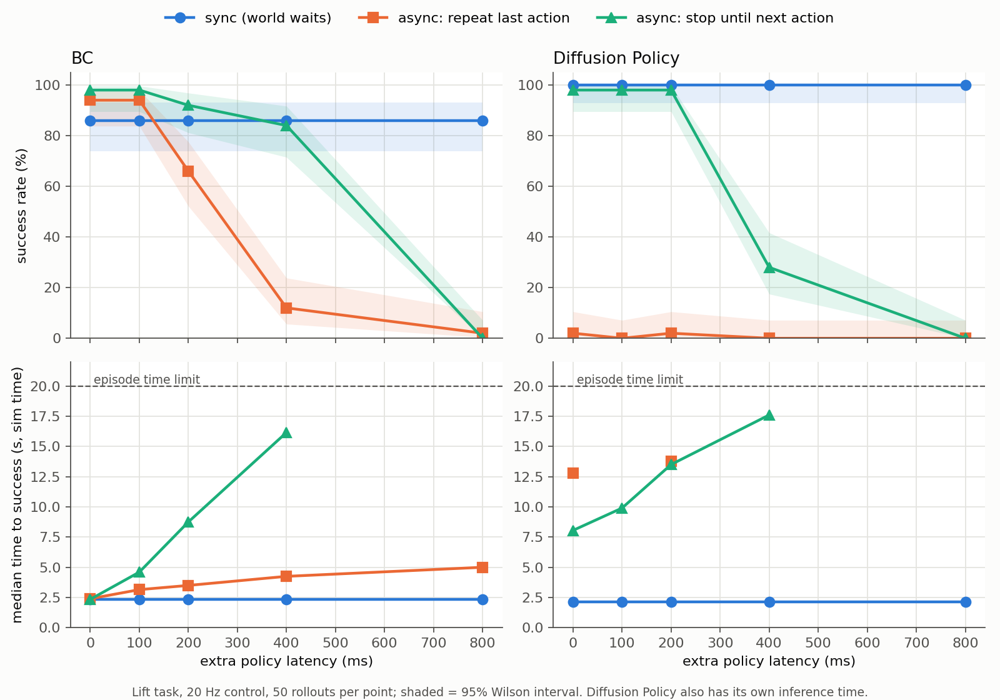

# mini-asyncsim

**What happens to a robot policy when the world doesn't wait for it to think?**

CSCI596 (Scientific Computing & Visualization) final project, Fall 2026.
A minimal re-implementation of the asynchronous-simulation idea from
[Robomimic_Async](https://github.com/LeeHakHo/Robomimic_Async), built on top of
stock [robomimic](https://github.com/ARISE-Initiative/robomimic) v0.5 and
[robosuite](https://github.com/ARISE-Initiative/robosuite) v1.5, and run on USC CARC.



## Problem

Robot-learning benchmarks evaluate policies **synchronously**: the simulator freezes
while the policy computes its next action. Real robots don't freeze. A large model
(e.g. Diffusion Policy, which runs many denoising steps per action) may take tens to
hundreds of milliseconds, and during that time the robot keeps moving (or stands
still). Synchronous benchmarks therefore hide the cost of inference latency.

## Method

```
            sync                                     async (this project)
 obs ─► policy (world paused) ─► step        physics process: step ─ step ─ step ─ step   (fixed wall-clock rate)
 obs ─► policy (world paused) ─► step                           ▲ latest action    │ latest obs  (shared memory)
                                              policy process: ──┴── infer ─────────┴── infer ──
```

* `asyncsim/async_env.py`: the physics runs in **its own process** and steps the
  robosuite env at `control_freq × real_time_rate` (20 Hz) in wall-clock time. The
  latest observation and action are exchanged through shared memory; control
  messages (reset / run / result) go over a pipe. No GIL contention between physics
  and inference, like a real robot controller and a separate policy server.
* What the robot does on a tick with no new action (`--hold`):
  * `repeat`: re-apply the last action (zero-order hold). Lift uses delta-pose
    (OSC_POSE) actions, so this keeps moving the arm and overshoots.
  * `stop`: apply each action once, then hold the arm still (keep the gripper
    command) until the next action arrives.
* `asyncsim/rollout.py`: `sync_rollout` and `async_rollout` use the same policy and
  the same injected latency, so the only difference is whether the world waits.
* Policies: BC (≈1 ms inference) and Diffusion Policy (≈135 ms inference on a CARC
  GPU, spikes up to ~1 s), trained with robomimic on **Lift** (low-dim
  observations, proficient-human demos) on CARC GPUs.
* Sweep: {BC, DP} × {sync, async-repeat, async-stop} × extra latency
  {0, 100, 200, 400, 800 ms}, 50 rollouts per cell = 30 cells, each an independent
  CARC Slurm array task (`carc/sweep.slurm`).

## Results

Success rate (%) over 50 rollouts. Async episodes are limited to 400 ticks (20 s of
sim time). Full numbers with 95% Wilson intervals: [`docs/summary.csv`](docs/summary.csv).

| extra latency      | 0 ms | 100 | 200 | 400 | 800 |
|--------------------|-----:|----:|----:|----:|----:|
| BC sync            |  86  |  86 |  86 |  86 |  86 |
| BC async-repeat    |  94  |  94 |  66 |  12 |   2 |
| BC async-stop      |  98  |  98 |  92 |  84 |   0 |
| DP sync            | 100  | 100 | 100 | 100 | 100 |
| DP async-repeat    |   2  |   0 |   2 |   0 |   0 |
| DP async-stop      |  98  |  98 |  98 |  28 |   0 |

1. **Sync hides latency completely.** Success is flat because the world waits. With a
   fixed seed and deterministic policies every sync cell is identical.
2. **Async with zero-order hold collapses.** Repeating a delta-pose action while the
   policy thinks overshoots the target. BC breaks down from 200 ms on. Diffusion
   Policy fails at **0 ms extra latency**: its own ~135 ms inference (~3 control ticks)
   is already enough. Synchronous evaluation ranks DP above BC (100% vs 86%); under
   real-time execution with zero-order hold the ranking flips.
3. **Stopping until the next action keeps success but costs time.** Median time to
   success grows from 2.4 s to 16 s (BC, +400 ms) and from 8 s to 17.6 s (DP).
   The 0% at +800 ms is mostly timeouts: the task is too slow to finish in 20 s, not
   a wrong motion.

Caveat: sync has one outcome per initial state, so the small differences between sync
and async at 0 ms (e.g. BC 86% vs 94–98%) are not a meaningful effect.

### Videos

Same initial state, three modes side by side (sync | async-repeat | async-stop):

* [`docs/videos/bc_lat200_side_by_side.mp4`](docs/videos/bc_lat200_side_by_side.mp4): BC, +200 ms
* [`docs/videos/dp_lat0_side_by_side.mp4`](docs/videos/dp_lat0_side_by_side.mp4): Diffusion Policy, no extra latency
* [`docs/videos/dp_lat200_side_by_side.mp4`](docs/videos/dp_lat200_side_by_side.mp4): Diffusion Policy, +200 ms

Single episodes are illustrations, not statistics; see the table for rates.

## Running on CARC

```bash
# 1. environment (once; run as a job, the login node limits processes)
bash carc/setup_env.sh
# 2. data + training (GPU jobs)
sbatch -A <account> carc/train.slurm bc
sbatch -A <account> carc/train.slurm diffusion_policy
# 3. smoke test without a trained policy
python scripts/eval.py --dummy --dataset datasets/lift/ph/low_dim_v15.hdf5 --mode async -n 2
# 4. evaluation sweep (job array, 30 cells)
BC_CKPT=... DP_CKPT=... sbatch -A <account> --array=0-29%10 carc/sweep.slurm
# 5. plots -> results/sweep_<jobid>/sweep.png + summary.csv
python scripts/plot.py results/sweep_<jobid>
# 6. videos
BC_CKPT=... DP_CKPT=... sbatch -A <account> carc/videos.slurm
```

## Status

- [x] Async env (two processes, shared memory) + sync/async rollouts
- [x] Train BC / Diffusion Policy on Lift
- [x] Latency sweep on CARC (30-task job array)
- [x] Plots + analysis
